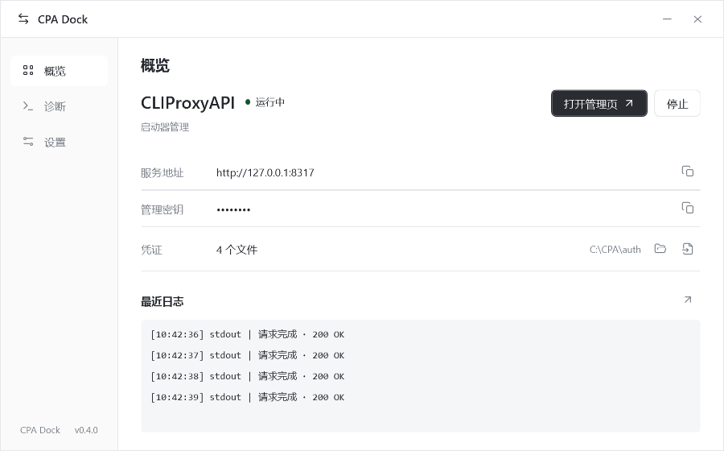

# CPA Dock

[CLIProxyAPI](https://github.com/router-for-me/CLIProxyAPI) 的 Windows 桌面启动器，用于管理本地服务、导入凭证和查看日志。

## 功能

- 安装、启动和停止 CPA，打开管理页。
- 选择或拖入 JSON 凭证文件，覆盖文件和重启服务时请求确认。
- 检查进程、配置和 HTTP 响应，搜索、筛选、复制和导出日志。
- 支持托盘运行、开机启动、自动启动 CPA 和深色模式。
- 分别检查和更新 CPA 与 CPA Dock。

## 下载与使用

1. 下载 [Windows x64 版](https://github.com/ohhellojie/cpa-dock/releases/latest/download/CPA-Dock-win-x64-self-contained.zip)。
2. 解压，运行 `CPA Dock.exe`。
3. 点击安装 CPA，或在设置中选择已有程序与 `config.yaml`。
4. 启动 CPA，打开管理页。

CPA Dock 原名 CPA Launcher，沿用原有设置。

[使用与恢复](docs/usage.md) · [源码构建](docs/building.md) · [发布记录](https://github.com/ohhellojie/cpa-dock/releases)

[MIT License](LICENSE)
